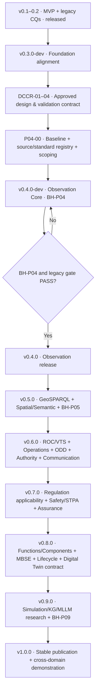

# MASS Ontology Stack — Integrated Roadmap v1.1 (MASS-OEF Aligned)

**Plan date:** 2026-10-27  
**Status:** APPROVED — governing release roadmap; planned modules and validation gates remain unimplemented until tested  
**Approval date:** 2026-10-27  
**Supersedes:** `MASS_Ontology_Roadmap_2026-10-27.md` (previous roadmap baseline)  
**Inputs:** MASS-OEF (ADOPTED 2026-10-27), previous roadmap, approved DCCR-01…DCCR-04, immutable MASS-SK-1.0.  
**Central rule:** MASS-OEF governs ontology engineering across the lifecycle; software versions govern incremental scope; BH-P04/P05/P09 define **validation profiles**, not release versions.

## A. Integrated dependency roadmap

**Per-release assurance track:** requirements/provenance/version record → conceptual definitions + competency questions → external reuse assessment → OWL/SHACL/rule specification → positive/negative fixtures → test execution/CI → controlled release.

## B. Release milestones and gates

| Version | Scope | New integrated MASS-OEF focus | Release acceptance |
|---|---|---|---|
| v0.1-v0.2 | MASS core and 14 legacy CQ path | Existing research MVP | Historical release record |
| v0.3.0-dev | BFO/CCO candidate foundation decisions | Source and provenance controls | Legacy catalog/SHACL/CQ green; no false equivalences |
| **v0.4.0-dev (BH-P04)** | `maritime:Vessel`, Trajectory, TemporalUnit, PhysicalBehavior, SOSA/SSN, QUDT, OWL-Time, PROV-O | Sensor/observation foundations; term source registry; pilot AIS slice | BH-V01,02,03,05,06,11,12 and BH-CQ-01..03 PASS; legacy gates PASS |
| v0.5.0 (BH-P05) | GeoSPARQL, EnvironmentSpace, interaction/semantic descriptions, inference graph separation | Navigation/situation/ODD geographic contexts | All applicable P04+P05 PASS; no unsupported COLREG inference |
| v0.6.0 | ROC, VTS, communication, human supervision, `OperationalConfiguration`, `FunctionAllocation`, ODD applicability | Socio-technical operational configuration and authority | Handover and loss-of-link CQs, contextual role/authority tests |
| v0.7.0 | STPA/FMEA safety, regulation applicability, safety claim/argument/evidence | MASS Code source-aware applicability and safety assurance | Hazard→requirement→evidence queries, non-actuating rule semantics, scenario simulation proof-of-concept |
| v0.8.0 | MASS functions and components, MBSE SysML v2 links, lifecycle/configuration provenance | Change impact, digital twin synchronization contract | Versioned transformation mappings, round-trip checks where supported |
| v0.9.0 (BH-P09) | KG/LLM experimental recognition, scenario replay/simulation | Probabilistic/evidence-based model and DT prototype | Offline/causal-online distinction, provenance, accuracy tests, no safety-certification claim |
| v1.0.0 | Modular curated ontology and example end-to-end case | Publishing and reuse of MASS-OEF research artefacts | Pinned imports, all applicable tests, documentation, limitations and governance approval |

**Separate normative watchlist (calendar, not ontology release dates):** Adopted non-mandatory IMO MASS Code effective 1 July 2026; IMO targets consideration of mandatory code by July 2030 for possible entry 2032. Changes in IMO/ISO source texts trigger impact review, **not** automatic ontology changes.

## C. P04 implementation: NO SCOPE EXPANSION

1. P04-00 — freeze current commit and legacy validation; normative source registry (metadata-only); select terminology and timestamp/segmentation policy; document later `OperationalConfiguration` concept without implementing it.
2. P04-01 — generic `maritime:Vessel` and compatibility with `mass:MASSVessel`, `nav:TargetShip`.
3. P04-02 — `bh:Trajectory`, `bh:TemporalUnit`, `bh:PhysicalBehavior`, `PositionState`, `SpeedState`, `CourseState`; temporal interval represented separately from information record.
4. P04-03 — link SOSA/SSN observations, QUDT speed/course values, OWL-Time, PROV-O; deterministic synthetic AIS fixture.
5. P04-04 — SHACL and Python validation of BH-V01, V02, V03, V05, V06, V11, V12; positive and rule-specific negative test cases.
6. P04-05 — BH-CQ-01,02,03 with expected binding assertions and legacy CQ-01…14 untouched.
7. P04-06 — `make behavior-test` and CI profile report: PASS/FAIL/DEFERRED/BLOCKED.
8. P04-07 — review and release only after full P04 gate; P05/P09 tests remain DEFERRED.

## D. MASS-OEF pilot as a vertical slice across versions

**Reference story:** restricted visibility encounter + loss of communications with ROC. **Do not put full scenario in P04 backlog.**

- P04: reconstruct observed AIS track, segments, measured course/speed with temporal and source provenance.
- P05: represent interacting vessel, nearby spatial zone and cautiously inferred interaction/context.
- v0.6: classify communication loss, allocated performer/supervisor/authority, applicable ODD, handover conditions.
- v0.7: trace relevant hazard, operational/safety constraints and applicable MASS Code requirements to evidence; simulation-based result is not regulatory approval.
- v0.8: trace function/system/interface design and software configuration to requirement and evidence.
- v0.9: evaluate KG/MLLM recognition and simulated replay as research without commanding a ship.
- v1.0: publish curated cross-domain example and evidence chain with documented limits.

## E. Architectural guardrails

1. Never overwrite `MASSKernel_v1.0.sysml` or retroactively turn DCCR approval into test success.
2. A vessel movement **process** differs from its observed **trajectory record**; `TemporalUnit` differs from `time:ProperInterval`.
3. `OperationalConfiguration` is a temporally qualified *integration context*, not a replacement for existing modes/functions/ODD/OE/encounters.
4. Function ≠ agent: performer, supervisor, authority holder and handover validity are explicit, time/context qualified relationships.
5. Applicable regulation is not the same as a blanket obligation or demonstrated legal compliance; separate instrument source, conditional applicability, claim and evidence.
6. External standards must have pinned versions/IRIs and reviewed licenses before imports; BFO/CCO candidates are not automatic OWL equivalences.
7. Keep OWL/SHACL conformance, engineering verification, operation risk and certification as **distinct gates**.
8. Rules/ontology may support situation recognition and alerts, not directly execute safety-critical vessel control.

## F. Approved governance work items (implementation pending)

- `docs/architecture/mass-oef-methodology.md` — controlled framework note with clean diagram and references; approved for repository publication.
- `docs/architecture/operational-configuration-adr.md` — explicit meaning and boundaries, target v0.6; proposed.
- `docs/standards/normative-source-registry.md` — source versions, expected applicability and update watchlist, metadata-only in P04-00; proposed.
- `docs/use-cases/roc-link-loss-encounter.md` — vertical pilot, broken down into version slices; proposed.
- Maintain a multi-view matrix `Structural / Functional / Operational / Assurance` and per-class record `definition, origin, owner, CQ, release, instance example`.

## G. Approval boundary

The integration of MASS-OEF into the release roadmap was **APPROVED on 2026-10-27**. Approval establishes the planning baseline, **not a claim that new GitHub ontology modules, test suites, or release gates have been implemented**. The immutable MASS-SK-1.0 and approved DCCR-01…04 are unchanged. Implementation starts at P04-00 after baseline and design decisions; a future v0.4.0 release requires evidence of executed passing tests.
